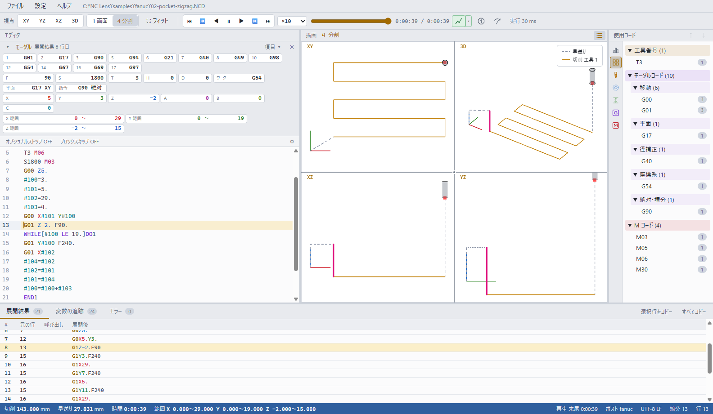
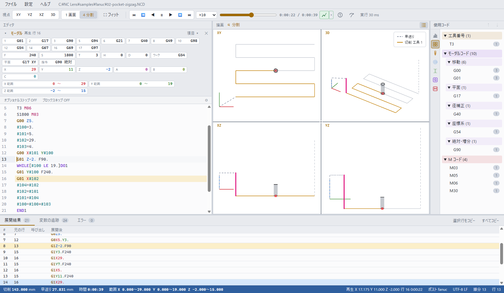
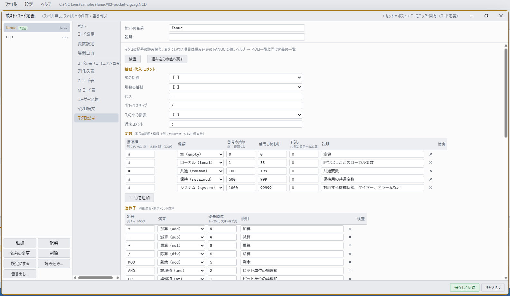
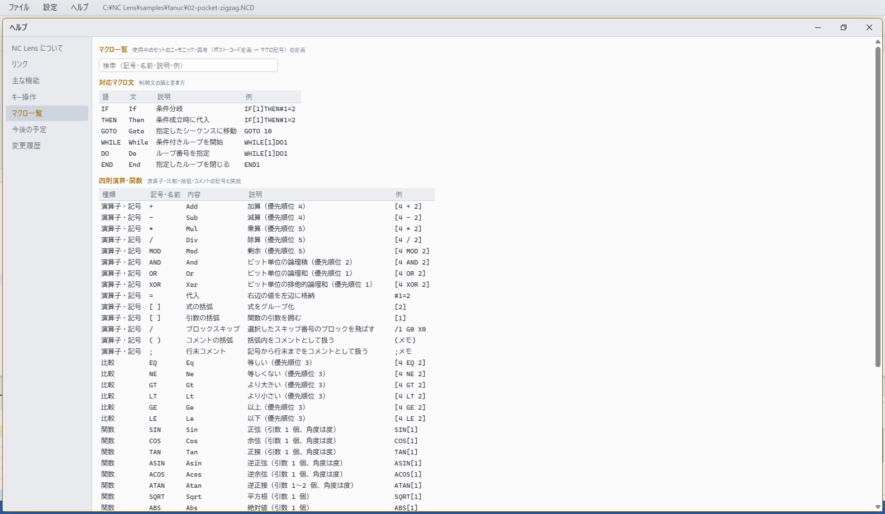
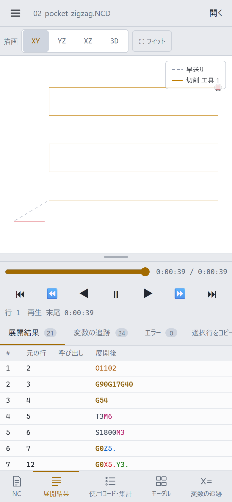

# NC Lens

[Web 版](https://nclens.factovo-works.com) · [最新版のダウンロード](https://github.com/factovo-mt/nc-lens/releases/latest)

NC プログラムのカスタムマクロと四則演算の展開、工具経路の描画と再生のアプリ。FANUC 系と OSP の NC を開き、展開した各行・変数の変化・エラーを元の行と照合。Windows 版と Web 版（ブラウザ、スマートフォン対応）。

- Web 版：<https://nclens.factovo-works.com>
- Windows 版のダウンロード：[GitHub Releases（最新版）](https://github.com/factovo-mt/nc-lens/releases/latest)

<picture>
  <source media="(prefers-color-scheme: dark)" srcset="docs/images/workspace-dark.png">
  
</picture>

## 主な機能

- 解析・展開：変数・計算式・IF・GOTO・WHILE・G65・G66・M98 の展開。OSP のユーザータスク（VC 変数・IF・GOTO・CALL）の基本範囲
- 展開結果・変数の追跡・エラーの表。行の選択で元の NC の行へ移動。開いた時・編集の 0.5 秒後・設定の変更時に自動で更新
- 描画：XY・YZ・XZ・3D と 4 分割。工具径補正 G41・G42、座標回転 G68 の経路
- 再生：再生・バック再生・1 ブロックずつの移動、完成形の薄表示、オプショナルストップ（M01）、ブロックスキップ（/1〜/9）
- モーダルパネル：カーソル・再生位置の行の実行後のモーダル
- 使用コード：NC に出るコードの一覧と出現位置。コードのツールチップ（見出し・説明・モーダル群の補足）
- 計測・レポート：切削・早送りの距離、推定の加工時間、座標の範囲、工具ごとの集計。JSON の保存
- ポスト・コード定義のセット：ポスト（機械条件・変数・展開出力）とニーモニック・固有（アドレス表・G コード表・M コード表・ユーザー定義・マクロ構文・マクロ記号）。FANUC・OSP を組み込み。TOML・JSON の入出力
- ヘルプのマクロ一覧：使用中のニーモニック・固有から作る対応マクロ文・四則演算と関数・変数の表
- NC ファイルの拡張子：.nc（既定）・.min・.ncd・.txt。文字コードは Shift_JIS（CP932）・UTF-8 を自動判定
- テーマ：ライト・ダーク・自動（OS の設定）

<picture>
  <source media="(prefers-color-scheme: dark)" srcset="docs/images/playback-dark.png">
  
</picture>

<picture>
  <source media="(prefers-color-scheme: dark)" srcset="docs/images/post-settings-dark.png">
  
</picture>

<picture>
  <source media="(prefers-color-scheme: dark)" srcset="docs/images/help-macro-dark.png">
  
</picture>

## Web 版

- ブラウザで利用。インストール不要。NC はブラウザ内で処理し、送信なし
- スマートフォン：上に描画、下のパネルをタブで切り替え（NC・展開結果・使用コード・集計・モーダル・変数の追跡）
- 保存はダウンロード（既定の拡張子 .nc）。設定はブラウザの保存領域

<picture>
  <source media="(prefers-color-scheme: dark)" srcset="docs/images/web-mobile-dark.png">
  
</picture>

## 動作環境

- Windows 版：Windows 10 / 11（x64）、Microsoft Edge WebView2 Runtime
- Web 版：最新の主要なブラウザ（スマートフォン・タブレットを含む）

## インストール（Windows 版）

[GitHub Releases](https://github.com/factovo-mt/nc-lens/releases/latest) の配布 ZIP を展開し、末尾が `-setup.exe` のインストーラを実行。MSI・ポータブル版も同梱。詳細は[利用ガイド](docs/user/README_配布用.md)。

## 使い方

1. Ctrl+O で NC ファイルを開く（ファイル → サンプルを開く、で同梱の[サンプル](samples/README.md)も選択可）
2. 自動で解析・展開。「展開結果」「変数の追跡」「エラー」のタブで確認。行の選択で元の行を強調
3. ツールバーの再生（Space・F5）で工具経路を確認。4 分割・3D で全体を把握
4. 設定 → ポスト・コード定義で機械条件とコード定義を調整。ファイル → 展開結果を保存で展開後の NC を保存

キー操作・機能の一覧はアプリのヘルプ（ヘルプ → ヘルプ）。

## プライバシー

- アクセス解析：Cloudflare Web Analytics（Web 版の公開用のみ）
- Cookie 不使用、個人の特定なし
- 集計の対象：訪問数・閲覧ページ・参照元・国・端末の種類
- 開いた NC の内容は送信しない（ブラウザ内で処理）
- Windows 版は通信なし（リンクを開く操作を除く）

## CLI・API

Rust の環境で、リポジトリのルートから実行。

```powershell
cargo install --path crates/nclens-cli --locked
nclens-cli expand work.nc --out expanded.nc
```

オプションとローカル HTTP API は[外部連携ガイド](docs/api/README.md)、GUI のビルド手順は[開発者向けガイド](app/README.md)。

## ライセンス

[MIT License](LICENSE)（[日本語参考訳](LICENSE-ja.txt)）。依存ライブラリの条件は[第三者ライセンス](THIRD_PARTY_LICENSES.md)、更新内容は[変更履歴](CHANGELOG.md)。
