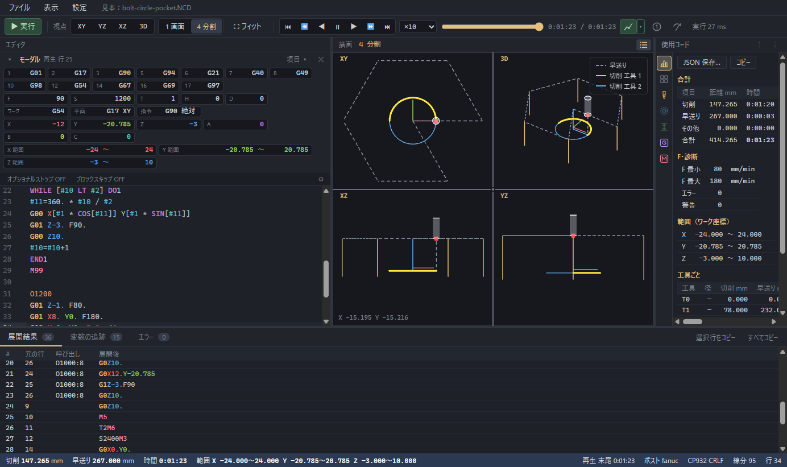
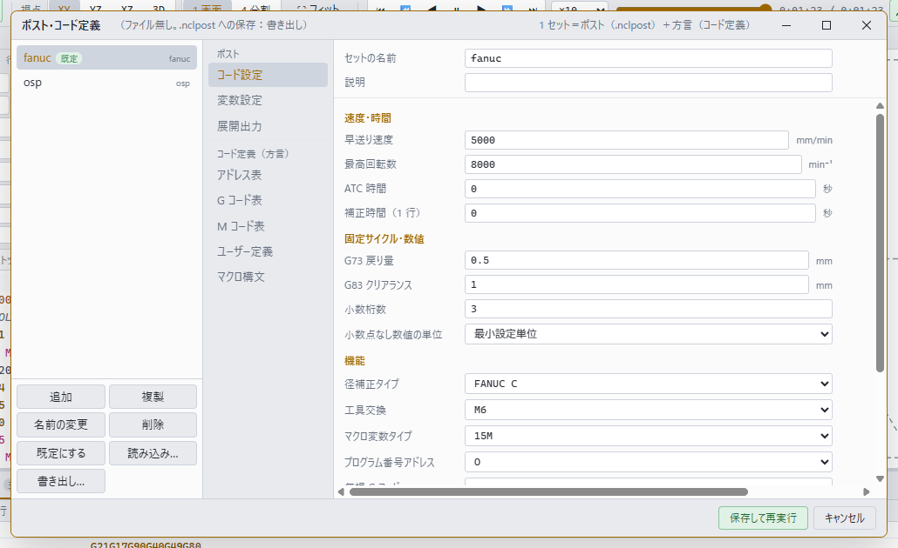

# NC Lens

[Web 版](https://nclens.factovo-works.com) · [最新版のダウンロード](https://github.com/factovo-mt/nc-lens/releases/latest)

NC Lens は、NC プログラムのカスタムマクロと四則演算を展開する Windows アプリです。FANUC 系の NC プログラムを開き、展開した各行、変数の変化、エラーを元の行と照合できます。

## 主な機能

- 変数、計算式、条件分岐、繰り返し、サブプログラム呼び出しの展開
- 工具経路の 2D・3D 表示と再生
- 切削・早送り距離、推定加工時間、座標範囲のレポート
- 機械条件に合わせたポストと G・M コードの設定。TOML・JSON で入出力
- ニーモニック・固有の設定：G・M コード、アドレス、マクロ記号（変数・演算子・比較・制御文・関数の記号）
- ヘルプのマクロ一覧：使用中の定義から作る対応マクロ文・四則演算と関数・変数の表





## インストール

Windows 10 / 11（x64）と Microsoft Edge WebView2 Runtime が必要です。[GitHub Releases](https://github.com/factovo-mt/nc-lens/releases/latest) の配布 ZIP を展開し、末尾が `-setup.exe` のインストーラを実行します。

## 使い方

1. Ctrl+O で NC ファイルを開きます。[ボルト穴と円形ポケットの見本](app/samples/bolt-circle-pocket.NCD)で試せます。
2. 開くと自動で解析・展開します（編集の 0.5 秒後と設定の変更時も自動）。「展開結果」「変数の追跡」「エラー」の各タブを確認します。結果の行を選ぶと、元の行が強調されます。
3. ツールバーの再生ボタン（Space・F5）で工具経路を確認します。「ファイル」メニューから展開結果を保存できます。

インストール、ポータブル版、その他の操作は[利用ガイド](docs/user/README_配布用.md)を参照してください。

## CLI・API

Rust が入った環境で、リポジトリのルートから実行します。

```powershell
cargo install --path crates/nclens-cli --locked
nclens-cli expand work.NCD --out expanded.NCD
```

詳しいオプションとローカル HTTP API は[外部連携ガイド](docs/api/README.md)を参照してください。GUI のビルド手順は[開発者向けガイド](app/README.md)にあります。

## ライセンス

[MIT License](LICENSE)（[日本語参考訳](LICENSE-ja.txt)）。依存ライブラリの条件は[第三者ライセンス](THIRD_PARTY_LICENSES.md)、更新内容は[変更履歴](CHANGELOG.md)を参照してください。
